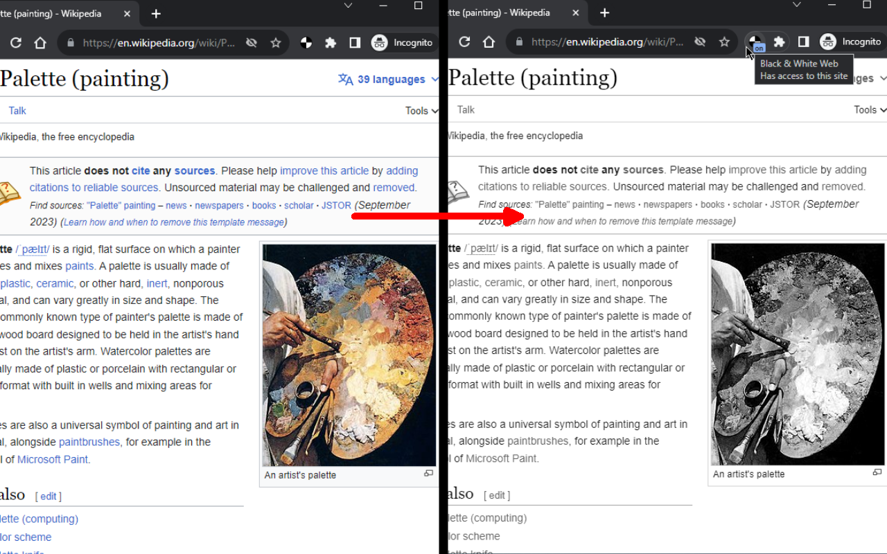

# Black & White Web
Browse the Web in Black & White.

Chrome Webstore link: https://chromewebstore.google.com/detail/Black%20%26%20White%20Web/eeghanoecgfjjflojdbjhmdpcdjceldh

# Overview
Click on the extension icon to turn any web page into Black & White.

Now you can also black list or white list urls in combination with Always ON option.
Should work for fullscreen videos too!

And more:
 - turn the extension always ON (also good for pranks :P )
 - show animated transition
 - advanced settings for custom filters

REPO: https://github.com/azrafe7/blackAndWhiteWeb

## ⚠️ Funny Filter Overrides
Invert: 
`invert(1)`

Blur: 
`blur(2px)`

Vintage: 
`contrast(1.2) sepia(.8)`

High contrast: 
`
contrast(1.1)
brightness(1.5)
saturate(1.1)
`

Subtle OCD: 
`
blur(0.25px) !important;
rotate: .12deg;
`

### SVG filters (might not work due to CSP)

Waves (https://www.stefanjudis.com/today-i-learned/svgs-filters-can-be-inlined-in-css/): 
`url('data:image/svg+xml, <svg xmlns="http://www.w3.org/2000/svg"> <filter id="waves" x="-20%" y="-20%" width="140%" height="140%" filterUnits="objectBoundingBox" primitiveUnits="userSpaceOnUse" color-interpolation-filters="linearRGB"> <feTurbulence type="turbulence" baseFrequency="0.01 0.01" numOctaves="1" seed="1" stitchTiles="noStitch" result="turbulence" /> <feDisplacementMap in="SourceGraphic" in2="turbulence" scale="20" xChannelSelector="G" yChannelSelector="A" result="displacementMap" /> </filter> </svg>#waves')`

Pixelated (https://neddev.com/en/lab/components/pixelate-svg-filter/): 
`url('data:image/svg+xml, <svg xmlns="http://www.w3.org/2000/svg" class="pxs__defs" width="0" height="0" aria-hidden="true" focusable="false"> <filter id="pxs-filter" x="0" y="0" width="100%" height="100%" color-interpolation-filters="sRGB"> <feFlood x="1" y="1" width="1" height="1" result="pxs-p"/> <feComposite in="pxs-p" in2="pxs-p" operator="over" width="3" height="3"/> <feTile result="pxs-raster"/> <feComposite in="SourceGraphic" in2="pxs-raster" operator="in"/> <feMorphology operator="dilate" radius="1"/> </filter> </svg>#pxs-filter')`

Posterize (https://tympanus.net/codrops/2019/01/29/svg-filter-effects-poster-image-effect-with-fecomponenttransfer/): 
`url('data:image/svg+xml, <svg xmlns="http://www.w3.org/2000/svg"> <filter id="posterize"> <feComponentTransfer> <feFuncR type="discrete" tableValues="0 .5 1"/> </feComponentTransfer> </filter> </svg>#posterize`

Glitch & others (https://www.svggenie.com/blog/advanced-svg-filters-glassmorphism-glitch)
